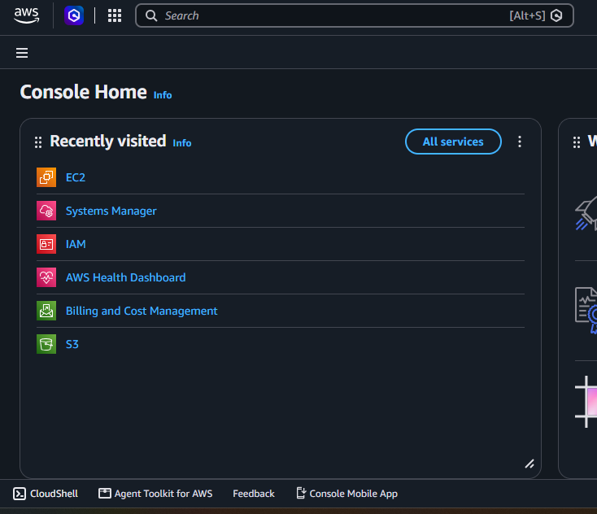
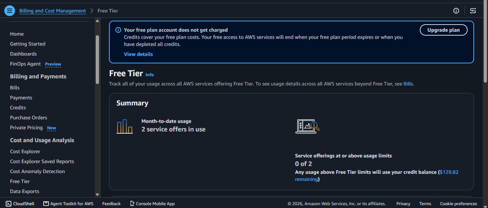
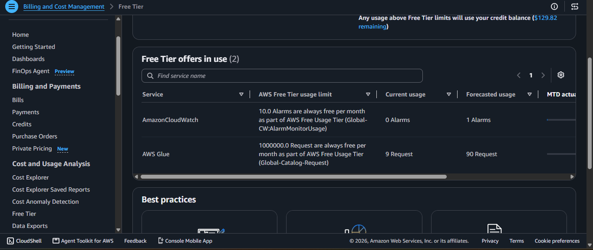
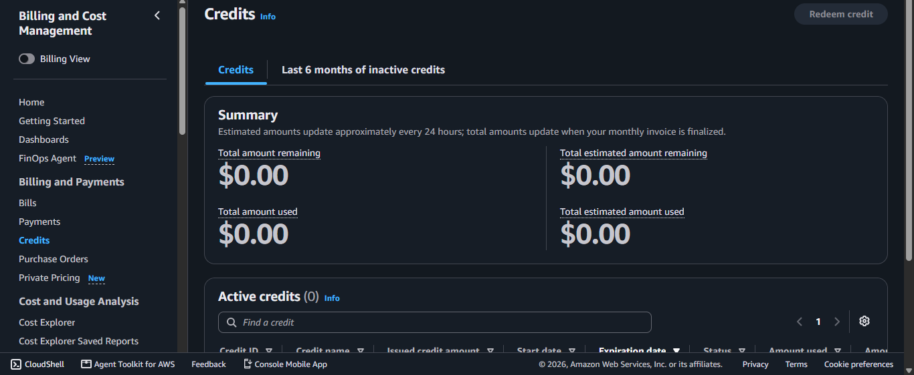
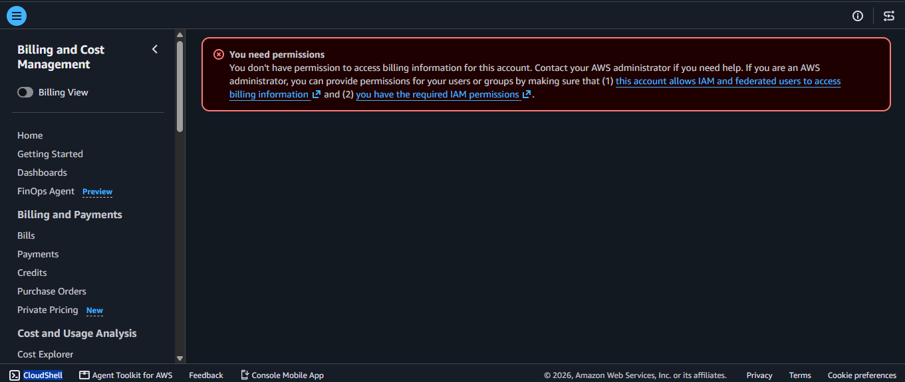
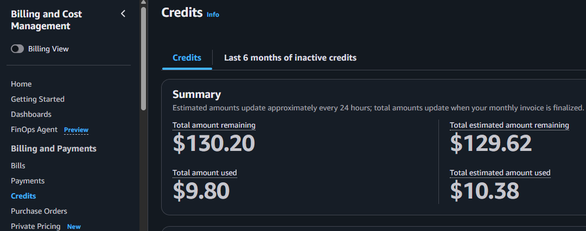
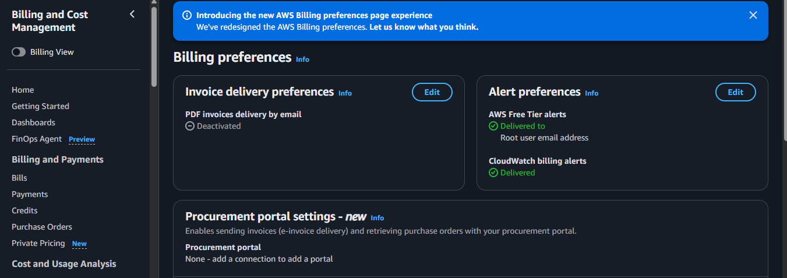
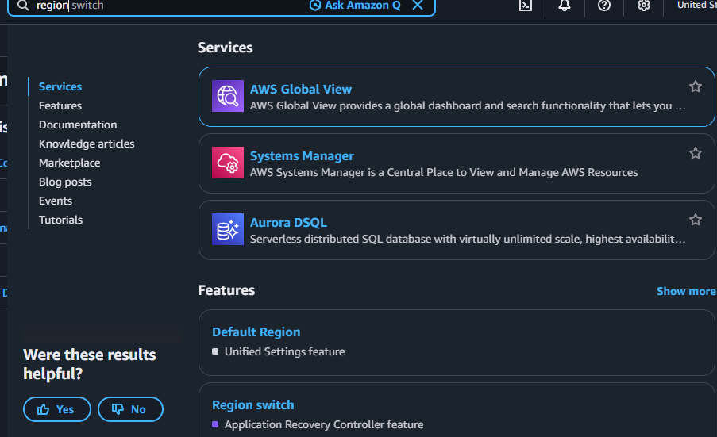
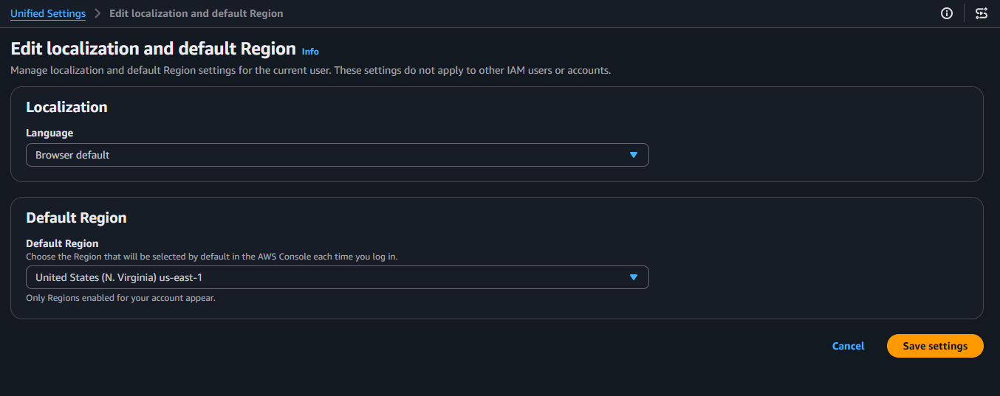

# Day 1 – AWS Lab Preparation

**Date and time checked:** 3 November 2026, 20:16

## Summary

| Item | Result |
|---|---|
| Account plan | Free Plan |
| Current month cost or usage amount | Not shown |
| Remaining credits | $129.62 total estimated amount remaining and $130.20 total amount remaining |
| Credits expiry date | 25 August 2027 (observation from my notes) |
| Usage warnings | None |
| Cost alert status | Activated |
| Chosen Region | United States (N. Virginia) `us-east-1` |
| Reason for Region choice | To be able to view CloudWatch billing metrics |

---

## Part 1: Open Billing Information

To confirm my free AWS account billing information, I signed in to the AWS account, searched for **Billing and Cost Management** in the console search bar and opened the Billing home page. Since this is a Free Tier account, I then opened **Free Tier** in the sidebar to track the services I am using that fall under the Free Tier. After that, I opened **Credits** in the sidebar to track how many credits I have used.

**Fig. 1 – Home page shown when signing in to the AWS account**

**Fig. 2 – Free Tier page (summary)**

**Fig. 3 – Free Tier page (offers in use)**

**Fig. 4 – Credits page (before permissions were changed)**

---

## Part 2: Record All That Was Shown

- I did not see any account plan shown.
- A current month cost or usage amount was not shown. Access was denied on the home page of the Billing and Cost Management console.
- $0 credits were shown on the Credits page.
- I did not see the Credits or Free Tier expiry date.
- No usage warnings were issued.
- This was checked on 3 November 2026 at 20:16.

---

## Part 3: Check Cost Alerts

To check the cost alerts on my AWS account, I went to **Billing preferences** in the left sidebar. I got an error message saying I needed permissions to view this page.

**Fig. 5 – Error message shown when opening the Billing preferences page**

To give my IAM user permission to view billing information, I signed out of the IAM user and signed in as the root user. I then opened **Account** in the root user's account menu and looked at **IAM User and Role Access to Billing Information** to see whether it was enabled or disabled. While signed in as root, I clicked **Edit**, selected **Activate IAM Access** and saved it.

After that, I signed out of the root account and signed back in to my IAM user. The Billing preferences page now showed details which are AWS Free Tier alerts were set to deliver to the root account email and CloudWatch alerts were also set to deliver to CloudWatch, and the Credits page finally showed credits as well.

**Fig. 6 and Fig. 7 – Results after the IAM user was given permission to view billing information**

**Fig. 6 – Credits page after the change**

**Fig. 7 – Billing preferences page after the change**

### Part 2: Record All That Was Shown (Renewed Answers)

- I did not see any account plan shown.
- A current month cost or usage amount was not shown.
- $129.62 remaining credits were shown on the Credits page.
- The Credits expiry date is 25 August 2027.
- No usage warnings were issued.
- This was checked on 3 November 2026 at 20:16.

---

## Part 4: Choose Your Lab Region

Going back to my home page, the next objective was to select the Region I will work in. To do that, I searched for "Region" in the search bar and selected **Default Region** under Features.

**Fig. 8 – Navigating to Default Region to select a Region**

Selecting **Default Region** in the Features section opens a page where the Region for the lab can be changed.

**Fig. 9 – Page where the lab Region is set**

I chose **United States (N. Virginia) us-east-1** because in this Region I am able to view CloudWatch billing metrics, this was however set in a previous internship I was involved in and not in this current exercise. After choosing the Region, I saved the settings and they applied.

---

## Part 5: Think About What I Found

- **Free Tier eligibility:** My account shows that I can run certain services, not all of them, and that they will not run on my own cost but on the free credits given to me.
- **The displayed amount:** It is my credit balance, showing how many credits I still have to work with.
- **Missing information:** I do not know if any information is missing.
- **Why check costs before deploying resources:** On the Free Tier, costs are limited. If I want my Free Tier account to cover not only the resources I am deploying now but also future resources, I need to manage them properly. On a paid account, personal or from an organisation, cost management is one of the skills of a good cloud engineer. Managing cost properly while making the best use of resources is one of the most desirable skills of a cloud engineer.
- **If I noticed unexpected usage:** If I noticed unexpected usage of any resource or of my free credits, I would investigate what it is and try to shut it down.

---

## Lessons Learned

- You need permissions to access certain resources, just as I did not have permission to access billing information at first and had to enable it.
- Before deploying any resources, assess your cost status.
- The Region your environment is configured in matters, because certain capabilities are restricted per Region. I chose `us-east-1` because I am able to view billing information there.

---

## Evidence

All screenshots are stored in the [`evidence`](evidence/) folder.

| Fig | File | What it shows |
|---|---|---|
| 1 | `01-console-home.png` | Console Home |
| 2 | `02-free-tier-summary.png` | Free Tier summary; shows $129.82 remaining credit balance |
| 3 | `03-free-tier-offers-in-use.png` | Free Tier offers in use (Amazon CloudWatch, AWS Glue) |
| 4 | `04-credits-before-permissions.png` | Credits page showing $0.00 before the permission change |
| 5 | `05-billing-permission-error.png` | "You need permissions" error on Billing preferences |
| 6 | `06-credits-after-permissions.png` | Credits page after the change: $130.20 total amount remaining, $129.62 total estimated amount remaining |
| 7 | `07-billing-preferences-alerts.png` | Billing preferences after the change: Free Tier alerts and CloudWatch billing alerts shown as delivered |
| 8 | `08-region-search-default-region.png` | Searching "region" and the Default Region feature |
| 9 | `09-default-region-us-east-1.png` | Default Region page set to United States (N. Virginia) us-east-1 |

[Back to main README](../README.md)
