# Day 2 — Root Account Security and MFA

Today's task is to review root account security and enable MFA if it is missing.

Date, time and timezone checked: 07/11/2026, 09:18am WAT

## Root Account Check

- MFA status before: Already assigned
- Action taken today: None
- MFA status after: It has already been assigned before so there was no need to assign it a new one
- Root access-key count: 0
- Root access-key status, if shown: Nil
- Returned to my existing IAM user: Success
- IAM sign-in result: Success

## Part 1: Open Root Security Credentials

Sign out of your IAM user and sign into the root account.

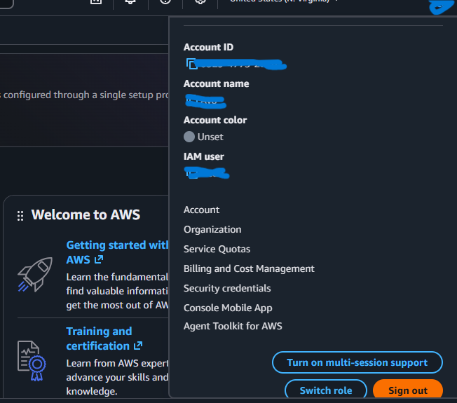

Fig 1 shows signing out of the IAM user account

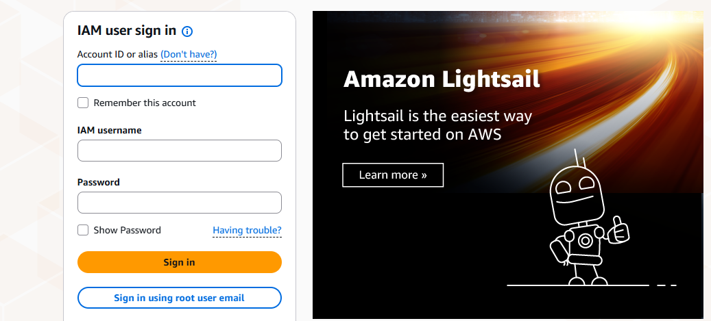

Fig 2 shows the page that will first show when we want to sign in to our account

As shown in Fig 2, we were brought back to the IAM user sign-in page; however, our aim is not to sign in as an IAM user but as the root user. To do that, you click the button at the bottom that shows "Sign in using root user email". Then you will be taken to the root user sign-in page.

Fig 3 shows the sign-in using root user email page

Add your email, click Next. You will be directed to the password page; enter your password, click Sign-in, and then you will be taken to the MFA page, where you will enter your MFA code.

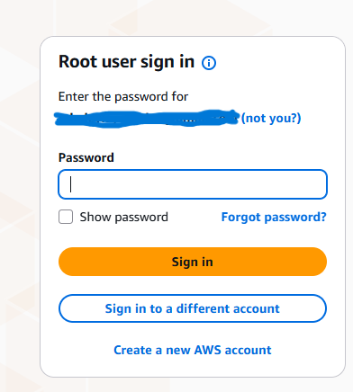

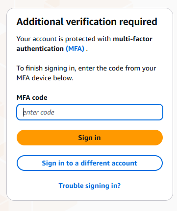

Fig 4 & 5 show the password and MFA pages during the root user sign-in process

After entering the MFA code, you will be directed to the Console page in the root user account. That is, in this account, you will be able to conduct activities as a root user. It is a high-privilege account.

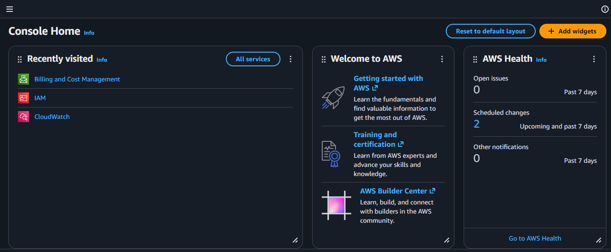

Fig 6 shows the Console Home page of the root user account

After getting to the Console Home page, navigate to the top right corner of the page where you will see the account's name, click it and the account's menu will come up.

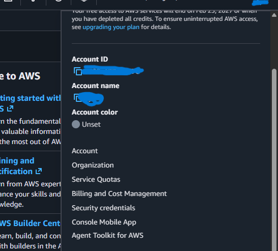

Fig 7 shows the root user account's menu

After the account's menu comes up, click on Security credentials. You will be taken to the IAM (Identity and Access Management) console home page; on this page, you will find the MFA panel, where you will know whether an MFA device has been assigned to this account.

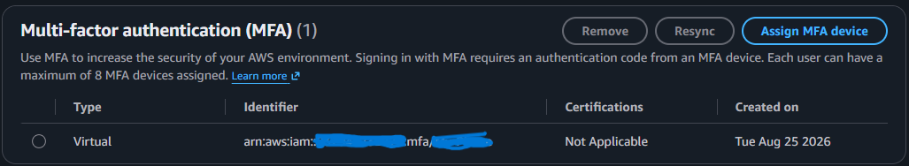

Fig 8 shows the MFA panel, and in this panel, there is already an assigned MFA device for this account.

As shown above, the root account already has an MFA device attached to it; however, if it didn't have an MFA device attached to it, you will have to assign it one.

## Part 2: Enable MFA if It Is Missing

In this case, MFA has already been enabled, but this part is for a scenario where MFA isn't enabled.

First, make sure you can access your account email and recovery phone number. Check privately; do not put them in your notes.

Still from the IAM console page, in the MFA panel, click on Assign MFA device. Then you will be directed to a page where you will assign MFA device name and choose device options. You can give it any name and then for the device options, choose Authenticator app, click Next. Then, you will be taken to the next field where you will be asked to Set up the Authenticator app. Just follow the instructions that were given. Then click Add MFA.

Fig 9

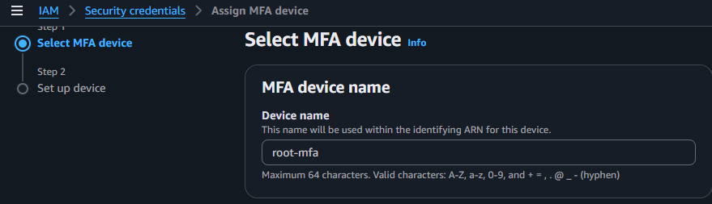

Fig 10

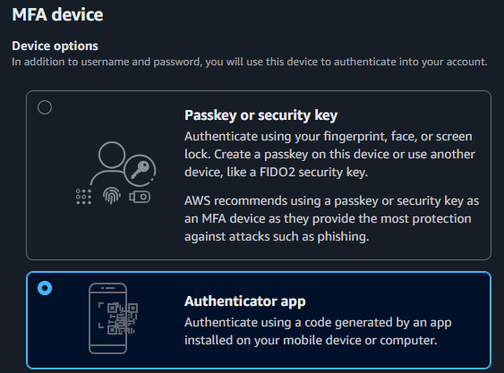

Fig 11

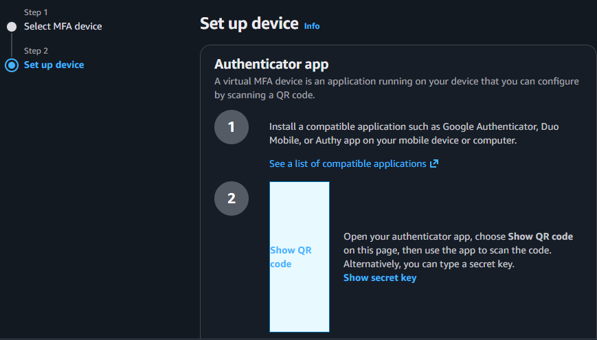

Fig 12

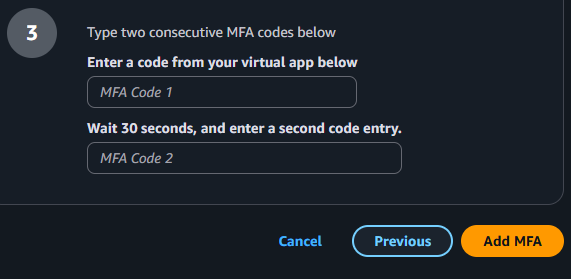

Fig 13

The above Fig 9-13 screenshots show the steps on how to assign an MFA device to the root account

## Part 3: Check Root Access Keys

Navigate back to the root account's Security Credentials page, find the Access keys panel and check whether any access key is being listed and their status.

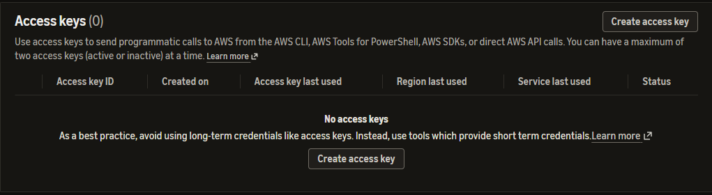

Fig 14 shows no access keys listed

## Part 4: Return to Your IAM User

Just as you signed out of the IAM user, sign out of the root account. After signing out, sign back in to the IAM user account. Confirm that the sign in succeeded and record it.

In my case, I have already created assigned MFA to the root account in the past and I could also access my IAM user account after assigning MFA to the root account.

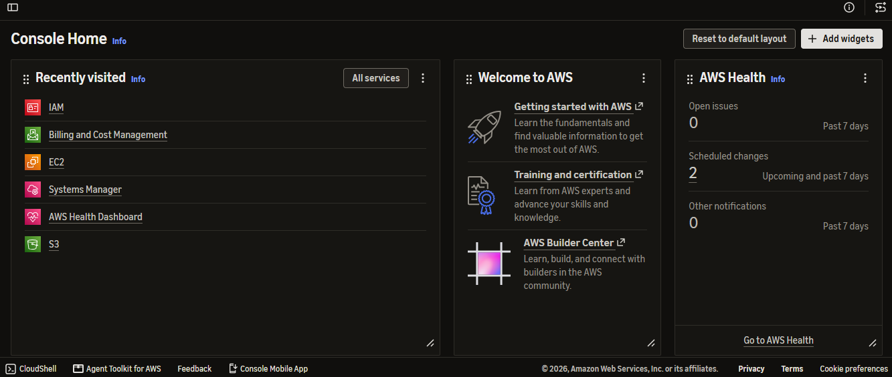

Fig 15 shows the Console Home page of the IAM user account.

## Part 5: Think About What You Found

1) MFA was already assigned to the root account before this exercise, in my previous internship.

2) If someone learns my password, MFA adds another layer of protection for the account to ensure that an unauthorized user will not have access to the account. MFA ensures that only an authorized user can have access to an account because it provides three considerations; at least two of them must be fulfilled before a user can access an account. These considerations include: something they know (password), something they have (authentication code or a hardware security module), or something they are (biometrics). For a user to access an account, they must provide at least two of these considerations; that is why MFA is sometimes referred to as 2FA (two-factor authentication).

3) NO, MFA does not provide perfect, absolute security over an AWS account. An AWS account can still be compromised if it has an access key through its command line. If a malicious actor is able to obtain an account's access key, they can gain access to that account through the command line, bypassing MFA.

4) No root access keys were listed, as seen in Fig 14. What this means is that a user can not assume the identity of the root account when working on the command line, he will not be able to work on the root account through the command line.

5) The reason I signed out of root and back into the IAM user is that it is not best security practice to use the root account for daily and routine tasks, which is why the IAM user account was created in the first place so we can use it to engage in daily tasks. The root user account is only used in scenarios where high privilege is needed to solve problems.

6) One thing I could verify was that a root account and an IAM user account are two different accounts, observing from the sign-in process of both accounts and their privileges, they are both different accounts with different privileges. The root account has higher privileges than the IAM user account; that means it can do more things in a higher capacity than the IAM user account.

What I could not verify was because I have already set them up was the assignment of MFA on the root account, which I have done in the past in a previous internship.

## What I Learned

It is important to set up MFA on the root account because it serves as a layer of defence against unauthorized access. It also protects the IAM users that are created under the root account.
